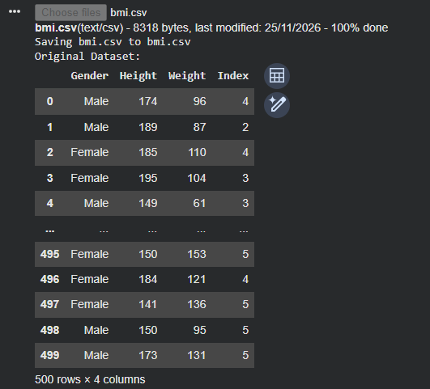
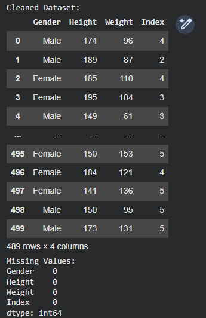
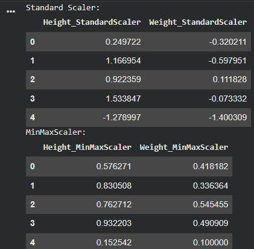
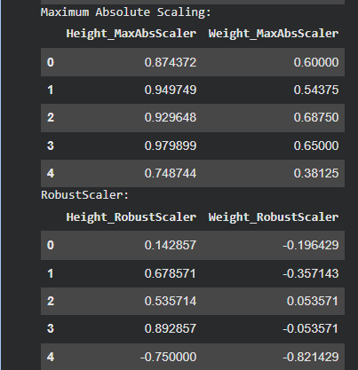
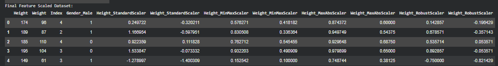
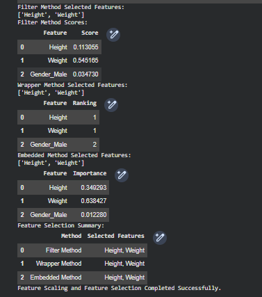

# EXNO:4-DS
# AIM:
To read the given data and perform Feature Scaling and Feature Selection process and save the
data to a file.

# ALGORITHM:
STEP 1:Read the given Data.

STEP 2:Clean the Data Set using Data Cleaning Process.

STEP 3:Apply Feature Scaling for the feature in the data set.

STEP 4:Apply Feature Selection for the feature in the data set.

STEP 5:Save the data to the file.

# FEATURE SCALING:
1. Standard Scaler: It is also called Z-score normalization. It calculates the z-score of each value and replaces the value with the calculated Z-score. The features are then rescaled with x̄ =0 and σ=1

2. MinMaxScaler: It is also referred to as Normalization. The features are scaled between 0 and 1. Here, the mean value remains same as in Standardization, that is,0.

3. Maximum absolute scaling: Maximum absolute scaling scales the data to its maximum value; that is,it divides every observation by the maximum value of the variable.The result of the preceding transformation is a distribution in which the values vary approximately within the range of -1 to 1.

4. RobustScaler: RobustScaler transforms the feature vector by subtracting the median and then dividing by the interquartile range (75% value — 25% value).

# FEATURE SELECTION:
Feature selection is to find the best set of features that allows one to build useful models. Selecting the best features helps the model to perform well.

The feature selection techniques used are:

1.Filter Method

2.Wrapper Method

3.Embedded Method

# CODING AND OUTPUT:

```

!pip install scikit-learn -q

from google.colab import files
import pandas as pd
import numpy as np

from sklearn.preprocessing import StandardScaler, MinMaxScaler, MaxAbsScaler, RobustScaler
from sklearn.feature_selection import SelectKBest, mutual_info_classif
from sklearn.feature_selection import RFE, SelectFromModel
from sklearn.ensemble import RandomForestClassifier

uploaded = files.upload()

df = pd.read_csv("bmi.csv")

print("Original Dataset:")
display(df)

df = df.dropna()
df = df.drop_duplicates()

print("Cleaned Dataset:")
display(df)

print("Missing Values:")
print(df.isnull().sum())

df = pd.get_dummies(df, columns=['Gender'], drop_first=True, dtype=int)

X = df.drop('Index', axis=1)
y = df['Index']

numeric_columns = ['Height', 'Weight']

scalers = {
    'StandardScaler': StandardScaler(),
    'MinMaxScaler': MinMaxScaler(),
    'MaxAbsScaler': MaxAbsScaler(),
    'RobustScaler': RobustScaler()
}

scaled_data = pd.DataFrame(index=df.index)

for name, scaler in scalers.items():
    scaled_values = scaler.fit_transform(X[numeric_columns])
    scaled_df = pd.DataFrame(
        scaled_values,
        columns=[col + '_' + name for col in numeric_columns],
        index=df.index
    )
    scaled_data = pd.concat([scaled_data, scaled_df], axis=1)

print("Standard Scaler:")
display(scaled_data.filter(like='StandardScaler').head())

print("MinMaxScaler:")
display(scaled_data.filter(like='MinMaxScaler').head())

print("Maximum Absolute Scaling:")
display(scaled_data.filter(like='MaxAbsScaler').head())

print("RobustScaler:")
display(scaled_data.filter(like='RobustScaler').head())

final_scaled = pd.concat(
    [df, scaled_data],
    axis=1
)

print("Final Feature Scaled Dataset:")
display(final_scaled.head())

X_scaled = pd.DataFrame(
    StandardScaler().fit_transform(X),
    columns=X.columns,
    index=X.index
)

filter_selector = SelectKBest(
    score_func=mutual_info_classif,
    k=2
)

filter_selector.fit(X_scaled, y)

filter_features = X.columns[filter_selector.get_support()]

print("Filter Method Selected Features:")
print(list(filter_features))

filter_scores = pd.DataFrame({
    'Feature': X.columns,
    'Score': filter_selector.scores_
})

print("Filter Method Scores:")
display(filter_scores)

model = RandomForestClassifier(
    n_estimators=100,
    random_state=42
)

rfe = RFE(
    estimator=model,
    n_features_to_select=2
)

rfe.fit(X_scaled, y)

wrapper_features = X.columns[rfe.support_]

print("Wrapper Method Selected Features:")
print(list(wrapper_features))

wrapper_results = pd.DataFrame({
    'Feature': X.columns,
    'Ranking': rfe.ranking_
})

display(wrapper_results)

embedded_model = RandomForestClassifier(
    n_estimators=100,
    random_state=42
)

embedded_model.fit(X_scaled, y)

embedded_selector = SelectFromModel(
    embedded_model,
    threshold=-np.inf,
    max_features=2
)

embedded_selector.fit(X_scaled, y)

embedded_features = X.columns[embedded_selector.get_support()]

print("Embedded Method Selected Features:")
print(list(embedded_features))

embedded_results = pd.DataFrame({
    'Feature': X.columns,
    'Importance': embedded_model.feature_importances_
})

display(embedded_results)

selection_summary = pd.DataFrame({
    'Method': ['Filter Method', 'Wrapper Method', 'Embedded Method'],
    'Selected Features': [
        ', '.join(filter_features),
        ', '.join(wrapper_features),
        ', '.join(embedded_features)
    ]
})

print("Feature Selection Summary:")
display(selection_summary)

final_scaled.to_csv("BMI_Feature_Scaling.csv", index=False)

selection_summary.to_csv("BMI_Feature_Selection.csv", index=False)

print("Feature Scaling and Feature Selection Completed Successfully.")

files.download("BMI_Feature_Scaling.csv")
files.download("BMI_Feature_Selection.csv")

```













# RESULT:

Thus, Feature Scaling techniques such as StandardScaler, MinMaxScaler, Maximum Absolute Scaling and RobustScaler were successfully applied. Feature Selection techniques such as Filter, Wrapper and Embedded methods were performed, and the processed datasets were saved as CSV files.

# SUMMARY:

In this experiment, I learned how to perform Feature Scaling and Feature Selection using Python, Pandas, and Scikit-learn. Feature Scaling techniques such as StandardScaler, MinMaxScaler, Maximum Absolute Scaling, and RobustScaler were applied to normalize numerical features.

Feature Selection was performed using Filter Method (SelectKBest), Wrapper Method (RFE), and Embedded Method (Random Forest Feature Importance) to identify the most important features.

Finally, the processed datasets were saved using df.to_csv() and downloaded using Google Colab's files.download() function.

Libraries Used:
- Pandas: Data loading, cleaning, and manipulation.
- NumPy: Numerical operations.
- Scikit-learn: Feature Scaling and Feature Selection.
- Google Colab Files: Uploading and downloading datasets.